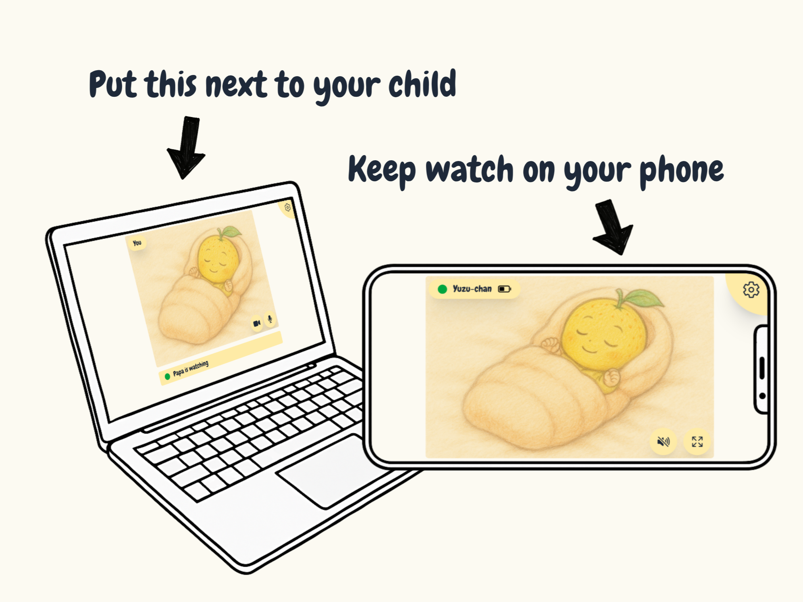

# Yuzukam

A privacy-first, self-hosted baby monitor for your local network.

## About

Yuzukam is a baby monitoring web-app meant to be self hosted in your local network - no data
stored, no cloud-connection, no subscriptions. Designed for privacy-minded parents that host their
own stuff.

## Setup

To use Yuzukam in your local network, some setup is required:
Browsers block webcam and microphone access on non-secure pages.
You’ll need to either enable HTTPS in your network or use a Chromium-based browser with a security
exception.

The following steps walk you through the best option of using a official letsencrypt certificate for
your local network.

### 1. Prerequisites

- **A home server** (or any other always-on device on your LAN) to run Yuzukam on.
- **A domain you own.**
- **A DNS provider that lets you manage records programmatically** (i.e. has an API) - most do.
- **A DNS server on your local network** that you control, e.g. AdGuard Home, Pi-hole, or your
  router's built-in DNS settings.

If you're already self-hosting things at home, there's a good chance you already have all of this.

### 2. Host Yuzukam

Run Yuzukam on your home server (or any other always-on device on your LAN) using Docker Compose or
the containerization system of your choice. Setup a reverse proxy that terminates HTTPS, like
Traefik - which also can create and renew the certificate automatically.
A detailed guide is in the making.

### 3. Prepare your camera device

Choose a device to place near your baby - usually an old laptop or something with a webcam and
microphone.

### 4. Start monitoring your baby

Open Yuzukam in the browser on your camera device. Position it so the webcam faces your baby.

> ⚙️ Click the gear icon in the top right to give the device a name (e.g. “nursery” or your baby's
> name).

Then, from any other device in your home network, open the same Yuzukam address to monitor the
stream.

> 🖥️ On first launch, each device is set to “Camera” mode. To switch a device to “Monitor” mode,
> click the gear icon in the top right, then tap the camera icon. This setting is saved on device
> and only needs to be changed once.

### Alternatives (not recommended)

If setting up a domain and DNS provider isn't an option for you, two fallbacks exist:

- **Chrome insecure-origin override**: in a Chromium-based browser (Chrome, Brave, Edge), visit
  [chrome://flags/#unsafely-treat-insecure-origin-as-secure](chrome://flags/#unsafely-treat-insecure-origin-as-secure)
  and add your host device's address as `http://<host>:<port>`. Desktop Chromium only - no mobile,
  no Safari/Firefox.
- **Self-signed / local CA certificate**: skips the domain/DNS requirement, but reliably installing
  a custom CA across every OS and browser today is enough of a hassle (some browsers keep their own
  certificate store instead of trusting the OS's) that it isn't recommended.

## Features

- Supports watching multiple babies from multiple devices simultaneously
- Lets you name devices for clarity (e.g. "nursery", "living room", or your child's name)
- Runs in any modern browser, on Linux, Windows and probably Mac!
- Gives new life to old devices

## Privacy

- ❌ No internet streaming (local network only)
- ❌ No recording or cloud storage
- ❌ No phoning home, no analytics, no tracking
- ❌ No account needed, no subscriptions

---

## Donations

The most valuable contribution to this project is your time and ideas. Open source becomes
meaningful through people participating in it.

If you would like to support the project financially, you can do so through the following options:

- [PayPal](https://www.paypal.com/donate/?hosted_button_id=9ZYAV83CAZ5A4)

Thank you for using, sharing, contributing and/or supporting the project in whatever way makes sense
to you.

---

## License

The source code for this project is licensed under the Mozilla Public License 2.0.
For details on third-party licensing, Docker image usage, bundled libraries, and UI asset rights,
please refer to the [NOTICE.md](./NOTICE.md) file.

---

**Yuzukam** is a self-hosted, local-only baby monitor built for privacy-conscious parents and DIY
home server setups. It runs entirely offline and is ideal for repurposing old devices as secure,
cloud-free baby cams.
